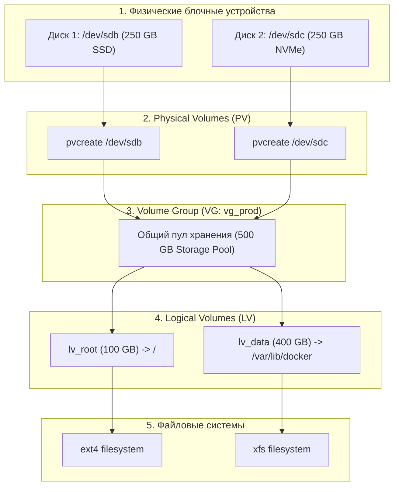
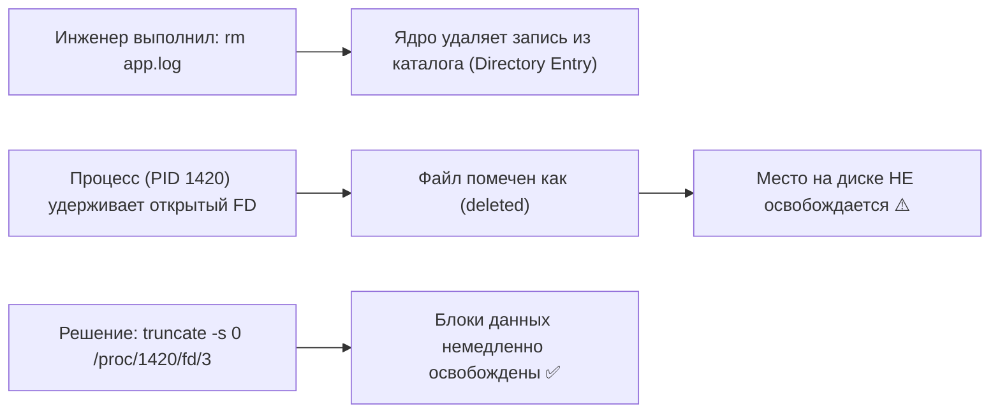

# Дисковая подсистема Linux: файлы, inodes, монтирование fstab и LVM

Нехватка дискового пространства и сбои монтирования при перезагрузке — одна из самых частых причин падения production-сервисов, баз данных и Docker-контейнеров. Глубокое понимание архитектуры файловых систем (`ext4`, `xfs`), механизмов распределения индексных дескрипторов (inodes) и технологии **LVM (Logical Volume Manager)** позволяет устранять инциденты на лету без остановки серверов.

В этом уроке мы разберем:
* Анализ дискового пространства и поиск виновников переполнения (`df`, `du`, `ncdu`).
* Проблему исчерпания инодов (`inodes`): почему диск полон при наличии сотен свободных гигабайт.
* Ловушку «удаленных» файлов (`deleted`), удерживаемых процессами, и их очистку через `/proc/<PID>/fd/`.
* Надежное монтирование дисков через `/etc/fstab` (флаги `nofail`, `noatime`, `UUID`).
* Архитектуру LVM и практическое горячее расширение разделов на 100% свободного места без простоя.

---

## 1. Архитектура хранилища: от дисков к LVM

В отличие от классического разбиения диска на жесткие разделы (`/dev/sda1`, `/dev/sda2`), **LVM** создает уровень абстракции, позволяя объединять разнородные физические накопители в единый гибкий пул:



---

## 2. Мониторинг свободного места и поиск утечек (`df`, `du`, `ncdu`)

```bash
# 1. Обзор свободного пространства в гигабайтах без виртуальных файловых систем:
df -h -x tmpfs -x devtmpfs

# 2. Поиск 10 самых тяжелых директорий в корне (глубина 1 уровень):
sudo du -xh --max-depth=1 / | sort -hr | head -n 10

# 3. Интерактивный терминальный анализатор занятого места:
sudo ncdu /var/log
```

---

## 3. Исчерпание инодов (Inodes): скрытая блокировка диска

Каждый файл и каталог в Linux занимает ровно один **inode (индексный дескриптор)**, хранящий метаданные (права, владельца, размер, временные метки и физические адреса блоков данных на диске). В файловой системе `ext4` общее число инодов фиксируется при форматировании раздела.

### Симптом аварии:
При попытке записать файл или запустить контейнер система возвращает ошибку:
```text
bash: cannot create temp file: No space left on device
```
При этом `df -h` показывает, что на диске свободно 200 ГБ!

### Диагностика и устранение:
```bash
# 1. Проверить свободные иноды (-i):
df -ih

# 2. Найти директорию с миллионами мелких файлов (кэши сессий, очереди почты):
sudo find / -xdev -printf '%h\n' | sort | uniq -c | sort -k 1 -n | tail -n 15

# 3. Скоростное пакетное удаление файлов (в разы быстрее rm -rf):
sudo find /var/spool/postfix/maildrop -type f -delete
```

---

## 4. Ловушка удаленных файлов: почему `rm` не освобождает место?

Если вы удалили гигантский файл логов командой `rm /var/log/app.log`, а свободное место в `df -h` не прибавилось, значит, этот файл **все еще открыт работающим процессом**. Ядро Linux не удалит блоки данных с накопителя, пока счетчик ссылок открытых дескрипторов процесса не станет равен нулю.



### Диагностика и быстрое решение без перезапуска сервиса:
```bash
# 1. Найти удаленные, но удерживаемые процессами файлы (+L1):
sudo lsof +L1

# Пример вывода:
# COMMAND  PID USER   FD   TYPE DEVICE SIZE/OFF NLINK NODE NAME
# java    1420  app    3w   REG  253,0  18.4GB     0 1234 /var/log/app.log (deleted)

# 2. Мгновенное обнуление размера файла через дескриптор в procfs:
sudo truncate -s 0 /proc/1420/fd/3
```

> [!TIP]
> Для очистки файла логов работающего сервиса никогда не используйте `rm`. Используйте обнуление: `> /var/log/app.log` или `truncate -s 0 /var/log/app.log`.

---

## 5. Надежное монтирование дисков: файл `/etc/fstab`

Таблица файловых систем `/etc/fstab` определяет правила автоматического монтирования блочных устройств при загрузке операционной системы.

### Определение постоянного UUID устройства:
```bash
sudo blkid
lsblk -f
```

### Пример эталонной записи в `/etc/fstab`:
```text
UUID=b5e2a14c-1234-4a21-9876-abcdef012345 /var/lib/docker ext4 defaults,noatime,nofail 0 2
```

### Ключевые флаги надежности и скорости:
* **`UUID=...`**: Всегда используйте уникальный UUID вместо имени `/dev/sdb1`, так как буквы дисков могут произвольно меняться после перезагрузки или добавления нового диска.
* **`nofail`**: Критически важный флаг для внешних накопителей! Если внешний том не ответит при загрузке, сервер продолжит штатную работу, а не зависнет в Emergency Recovery Shell.
* **`noatime`**: Отключает запись времени последнего чтения файлов, существенно снижая износ SSD и накладные расходы на I/O.
* **`mount -a`**: Всегда проверяйте синтаксис fstab перед перезагрузкой (`sudo mount -a`). Если команда вернула ошибку — исправьте её, иначе сервер не загрузится.

---

## 6. LVM: Горячее расширение раздела без простоя

В облачной инфраструктуре вы увеличили размер диска в веб-панели провайдера. Как добавить место в работающий раздел `/dev/mapper/vg_prod-lv_data` без отмонтирования и перезагрузки?

```bash
# 1. Сообщить ядру о новом размере диска без перезагрузки:
echo 1 | sudo tee /sys/class/block/sdb/device/rescan

# 2. Расширить Physical Volume:
sudo pvresize /dev/sdb

# 3. Расширить Logical Volume и файловую систему за одну команду (-r):
sudo lvextend -r -l +100%FREE /dev/mapper/vg_prod-lv_data

# 4. Проверить результат:
df -h /var/lib/docker
```

Флаг `-r` (`--resizefs`) автоматически вызывает соответствующую утилиту расширения: `resize2fs` для файловых систем `ext4` или `xfs_growfs` для `xfs`.

---

## 7. Вопросы для самопроверки

<details>
<summary>Вопрос 1: Команда df -h показывает 100% заполнения диска, но вы удалили тяжелый файл командой rm. Почему место не освободилось?</summary>
<div class="mt-2 text-body">
Файл был открыт работающим процессом (например, сервером приложений или базой данных). Ядро удалило имя файла из директории (unlink), но пока процесс удерживает открытый файловый дескриптор, физические блоки данных на диске не освобождаются. Найти такой файл можно командой <code>lsof +L1</code>, а освободить место без перезагрузки процесса — обнулением дескриптора через <code>truncate -s 0 /proc/&lt;PID&gt;/fd/&lt;FD&gt;</code>.
</div>
</details>

<details>
<summary>Вопрос 2: Зачем указывать опцию nofail в /etc/fstab для подключаемых дисков?</summary>
<div class="mt-2 text-body">
По умолчанию при ошибке монтирования любого устройства из <code>/etc/fstab</code> systemd прерывает загрузку сервера и переходит в аварийный режим Emergency Shell, требующий ввода пароля root в консоли (что недоступно на удаленных VDS без KVM/VNC). Опция <code>nofail</code> указывает системе продолжить нормальную загрузку ОС, даже если диск недоступен.
</div>
</details>

<details>
<summary>Вопрос 3: В чем преимущество опции noatime при монтировании разделов с базами данных и Docker?</summary>
<div class="mt-2 text-body">
По стандарту POSIX при каждом чтении файла операционная система выполняет операцию записи метаданных, обновляя метку времени последнего доступа (atime). Опция <code>noatime</code> отключает эту запись, устраняя паразитный дисковый ввод-вывод и ускоряя работу баз данных, веб-серверов и контейнеров на 15–30%.
</div>
</details>

---

## 8. Дополнительные материалы

* [Модуль 1: Права доступа в Linux, модель безопасности и Systemd](/courses/linux/01-permissions-and-systemd)
* [Модуль 3: Управление процессами и системные лимиты](/courses/linux/03-processes-and-system-limits)
* [Модуль 4: Bash-скриптинг для DevOps](/courses/linux/04-bash-automation-and-scripting)
* [Модуль 3: Тома, хранилище и постоянство данных в Docker](/courses/docker-storage/01-volumes-and-data-persistence)
