# Урок 1: Введение в системные контейнеры LXC и Incus: Архитектура и первый запуск

В современной разработке слово «контейнер» почти всегда ассоциируется с Docker или Podman. Однако Docker решает задачу изоляции **отдельных процессов приложений** (Application Containers). 

Существует принципиально другой класс контейнеризации — **Системные контейнеры (System Containers)**, эталоном которых являются проекты **LXC (Linux Containers)** и **Incus**.

В этом уроке мы разберем:
1. **Принципиальные отличия системных контейнеров от прикладных (LXC vs Docker)** и от классических виртуальных машин (KVM/QEMU).
2. **Эволюция стека**: от ядра Linux 2.6.29 и чистого LXC к LXD и независимому форку **Incus** под эгидой Linux Containers Community.
3. **Роль PID 1**: почему внутри LXC работает полноценный `systemd`, `cron`, `journald`, `sshd` и как это влияет на архитектуру сервисов.
4. **Установка и инициализация окружения (`incus admin init` / `lxd init`)**: настройка пулов хранения и виртуального сетевого моста.
5. **Жизненный цикл контейнера**: запуск дистрибутивов (Ubuntu, Debian, Alpine), интерактивная консоль, инспекция и мониторинг.

---

## 1. Системные контейнеры (LXC/Incus) vs Прикладные (Docker) vs Виртуальные машины (KVM)

Контейнеры LXC занимают уникальную нишу: они предоставляют пользовательский опыт полноценной виртуальной машины, но функционируют на нативной скорости «голого железа» (bare-metal) без гипервизора.

```mermaid
flowchart TD
    subgraph VM ["Виртуальная машина (KVM)"]
        A1["Guest Apps"] --> S1["Guest OS (Systemd)"]
        S1 --> K1["Guest Kernel"]
        K1 --> H1["Hypervisor (QEMU/KVM)"]
        H1 --> HK1["Host Kernel & Hardware"]
    end

    subgraph LXC ["Системный контейнер (LXC/Incus)"]
        A2["Multi-Process Services"] --> S2["Guest OS (Systemd, Cron, SSH)"]
        S2 --> HK2["Host Kernel (Cgroups v2 + Namespaces)"]
        HK2 --> HW2["Hardware (Direct Bare-Metal Speed)"]
    end

    subgraph Docker ["Прикладной контейнер (Docker)"]
        A3["Single Process (Go/Node PID 1)"] --> HK3["Host Kernel"]
        HK3 --> HW3["Hardware"]
    end
```



### Сравнительная таблица:

| Характеристика | Docker / Podman | LXC / Incus | KVM / Proxmox VM |
|---|---|---|---|
| **Назначение** | Изоляция одного сервиса/микросервиса | Изоляция полноценной ОС | Эмуляция физического сервера |
| **Процесс PID 1** | Ваше приложение (bin, node, python) | Полноценный `systemd` / `init` | Ядро гостевой ОС (`vmlinuz`) |
| **Жизненный цикл** | Ephemeral (уничтожается при обновлении) | Stateful (долгоживущий диск, как у VM) | Stateful (виртуальный диск qcow2/raw) |
| **Потребление RAM в простое** | 5–15 МБ | 15–35 МБ | 512 МБ – 1 ГБ (на ядро гостя) |
| **Скорость дискового ввода-вывода (I/O)** | Накладные расходы OverlayFS CoW | Прямой доступ к ZFS/Btrfs (нативная) | Эмуляция virtio-scsi контроллера |
| **Сетевая адресация** | NAT / Docker Bridge / Overlay | Свой реальный MAC/IP в LAN (Macvlan) | Виртуальная сетевая карта tap/bridge |

> [!NOTE]
> В системном контейнере LXC вы можете запустить `apt install postgresql`, настроить резервное копирование в `cron`, активировать `systemctl enable nginx` — и всё это будет работать точно так же, как на выделенном сервере, без сложностей с монтированием томов Docker.

---

## 2. Эволюция: LXC, LXD и форк Incus

* **2008 год**: в ядро Linux добавлены namespaces и cgroups. Проект **LXC** стал первым публичным инструментом контейнеризации в Linux (именно на низкоуровневых библиотеках LXC изначально строился Docker до появления `libcontainer` и `runc`).
* **2014 год**: Canonical создала **LXD** — демонизированный гипервизор контейнеров с REST API, поддержкой снапшотов ZFS, кластеризацией и профилями.
* **2023 год**: Canonical изменила лицензирование и передала LXD под закрытое корпоративное управление. В ответ создатели оригинального проекта Linux Containers и сообщество форкнули кодовую базу в полностью открытый проект **Incus**, ставший де-факто новым открытым стандартом системных контейнеров.

> [!TIP]
> Команды утилит `incus` и `lxc` в 99% случаев идентичны по синтаксису (`incus launch` = `lxc launch`). В современных дистрибутивах (Debian 12+, Arch, Ubuntu 24.04) рекомендуется использовать **Incus**.

---

## 3. Архитектура демона Incus и хранилища

Демон Incus работает в фоновом режиме под управлением `systemd` и слушает локальный UNIX-сокет `/var/lib/incus/unix.socket` (или защищенный HTTPS-порт `8443` для удаленного администрирования).

### Инициализация окружения:
Перед первым запуском контейнеров необходимо настроить дисковый пул и виртуальную сеть:
```bash
sudo incus admin init
```
В мастере конфигурации задаются:
1. **Storage Pool**: рекомендуется выбрать бэкенд **ZFS** или **Btrfs** для поддержки мгновенных снимков и аппаратного Copy-on-Write (если пул не создан, Incus предложит создать loop-файл).
2. **Network**: создание моста `incusbr0` с адресацией IPv4 (например `10.0.8.1/24`) и автоматической раздачей IP через встроенный `dnsmasq`.

---

## 4. Практика: Управление системными контейнерами

### Запуск контейнера из удаленного реестра образов
Incus обращается к глобальному каталогу официальных образов `images:`, где поддерживаются десятки дистрибутивов: Ubuntu, Debian, Rocky Linux, AlmaLinux, Alpine, Arch Linux, OpenSUSE:

```bash
# Запуск системного контейнера с Ubuntu 24.04 LTS под именем srv-db
incus launch images:ubuntu/24.04 srv-db

# Запуск легковесного контейнера на базе Alpine Linux (потребляет всего 8 МБ RAM!)
incus launch images:alpine/3.20 srv-proxy
```

### Просмотр списка контейнеров и метрик:
```bash
incus list
```
Пример вывода команды:
```
+-----------+---------+--------------------+-----------------------------------------------+-----------+-----------+
|   NAME    |  STATE  |        IPV4        |                     IPV6                      |   TYPE    | SNAPSHOTS |
+-----------+---------+--------------------+-----------------------------------------------+-----------+-----------+
| srv-db    | RUNNING | 10.0.8.142 (eth0)  | fd42:474b:c871:a8e0:216:3eff:fe7a:1 (eth0)   | CONTAINER | 0         |
| srv-proxy | RUNNING | 10.0.8.199 (eth0)  | fd42:474b:c871:a8e0:216:3eff:fe8c:2 (eth0)   | CONTAINER | 0         |
+-----------+---------+--------------------+-----------------------------------------------+-----------+-----------+
```

### Вход в окружение и работа с сервисами:
```bash
# Неинтерактивное выполнение команд от имени root
incus exec srv-db -- apt-get update
incus exec srv-db -- apt-get install -y postgresql

# Интерактивная сессия Bash
incus exec srv-db -- bash

# Внутри контейнера проверяем systemd и статусы служб:
root@srv-db:~# systemctl status postgresql
root@srv-db:~# ps -ef
```
> [!IMPORTANT]
> Обратите внимание: внутри контейнера запущен полноценный процесс `/sbin/init` (PID 1), который управляет деревом процессов в точности как на физическом сервере.

### Управление состоянием:
```bash
# Остановка контейнера
incus stop srv-db

# Запуск
incus start srv-db

# Перезагрузка гостевой ОС через штатный вызов systemd
incus restart srv-db

# Удаление контейнера
incus delete srv-db
```

---

## 5. Лабораторная работа

1. Установите Incus или классический LXD в вашей системе (например, в Debian/Ubuntu `sudo apt install incus` или через пакетный менеджер дистрибутива).
2. Запустите системный контейнер с Debian 12 под именем `lab-node`:
```bash
incus launch images:debian/12 lab-node
```
3. Войдите в консоль контейнера и убедитесь, что процесс PID 1 — это `/sbin/init`:
```bash
incus exec lab-node -- ps -p 1 -o pid,comm
```
4. Установите веб-сервер Nginx внутри контейнера и убедитесь, что он запустился как служба `systemd`:
```bash
incus exec lab-node -- apt update
incus exec lab-node -- apt install -y nginx
incus exec lab-node -- systemctl is-active nginx
```
5. Получите IP-адрес контейнера и выполните HTTP-запрос с хоста:
```bash
IP=$(incus list lab-node -c 4 --format csv | awk '{print $1}')
curl -I http://$IP
```
6. Удалите лабораторный стенд:
```bash
incus stop lab-node && incus delete lab-node
```
