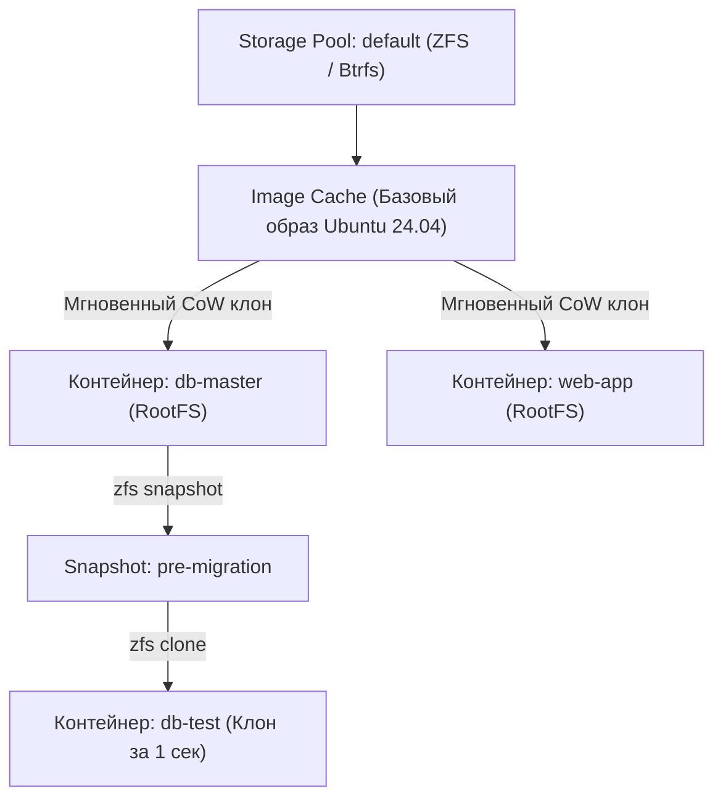

# Урок 2: Хранилища системных контейнеров: ZFS, Btrfs, моментальные снимки и квоты

В прикладных контейнерах (Docker) файловая система эфемерна, а для баз данных приходится выносить данные в именованные тома. В **системных контейнерах (LXC / Incus)** диск контейнера является постоянным (Stateful RootFS) — точно так же, как виртуальный диск в KVM или Proxmox VE.

Чтобы системные контейнеры запускались за доли секунды, не занимали гигабайты дублирующихся файлов ОС и мгновенно бэкапились, в них используется архитектура **Storage Pools** на базе продвинутых файловых систем.

В этом уроке мы разберем:
1. **Драйверы хранилища Incus/LXC**: сравнение `dir`, `btrfs`, `zfs`, `lvm` и распределенного `ceph`.
2. **Почему ZFS — стандарт индустрии для LXC и Proxmox VE**: Copy-on-Write, прозрачное сжатие (LZ4/ZSTD) и мгновенное клонирование.
3. **Ограничение дискового пространства**: установка жестких квот (`limits.disk`).
4. **Моментальные снимки (Snapshots)**: ручные бэкапы, автоматическое расписание с ротацией и откат состояния (`restore`).
5. **Экспорт, резервное копирование и миграция** контейнеров между серверами.

---

## 1. Архитектура Storage Pools в Incus / LXC

Все контейнеры создают свои корневые файловые системы внутри определенного пула хранения (Storage Pool).



### Сравнение драйверов хранилища:

| Драйвер | Мгновенный запуск (CoW) | Сжатие диска | Моментальные снимки (Snapshots) | Ограничение квот (`limits.disk`) | Рекомендация |
|---|---|---|---|---|---|
| **`zfs`** | Да | Да (LZ4, ZSTD) | Да (аппаратные ZFS снапшоты) | Да (нативно через ZFS dataset) | **Золотой стандарт** для Proxmox и Production |
| **`btrfs`** | Да | Да (ZSTD, LZO) | Да (Btrfs subvolumes) | Да (qgroups) | Отличный выбор для одиночных серверов без ZFS |
| **`lvm`** | Да (LVM thin) | Нет | Да (LVM snapshots) | Да | Для энтерпрайз-окружений с LVM |
| **`ceph`** | Да (RBD) | Да | Да | Да | Для высокодоступных (HA) кластеров из десятков нод |
| **`dir`** | Нет (rsync копия) | Нет | Медленно (копирование файлов) | Нет (или ограничено ext4 quota) | **Только для тестов** (медленный) |

> [!WARNING]
> Никогда не используйте драйвер `dir` на продакшене. При создании каждого нового контейнера `dir` копирует гигабайты файлов через `rsync`, тратя время и дисковое пространство. С `zfs` или `btrfs` создание нового контейнера из образа занимает менее 0.5 секунды!

---

## 2. Управление Storage Pools в Incus

### Просмотр существующих пулов и дисков:
```bash
incus storage list
```
Пример вывода:
```
+---------+--------+------------------+-------------+---------+---------+
|  NAME   | DRIVER |      SOURCE      | DESCRIPTION | USED BY |  STATE  |
+---------+--------+------------------+-------------+---------+---------+
| default | zfs    | /var/lib/incus/..| Local ZFS   | 6       | CREATED |
+---------+--------+------------------+-------------+---------+---------+
```

### Создание нового ZFS-пула на физическом NVMe диске или разделе:
```bash
# Создание пула fast-storage на выделенном NVMe диске
sudo incus storage create fast-storage zfs source=/dev/nvme0n1p3

# Включение сжатия ZSTD для экономии места без потери скорости CPU:
sudo incus storage set fast-storage zfs.clone_copy=false
```

---

## 3. Квоты дискового пространства

По умолчанию контейнер может занять весь свободный объем пула хранения. Чтобы защитить сервер от переполнения диска, устанавливают лимит `limits.disk`:

```bash
# Ограничить размер диска контейнера srv-db до 20GB:
incus config device set srv-db root size 20GiB

# Проверка установленного лимита:
incus config show srv-db --expanded
```
Внутри контейнера команда `df -h /` сразу отобразит максимальный размер диска ровно `20G`.

---

## 4. Моментальные снимки (Snapshots) и откат

Снимки состояния в ZFS и Btrfs делаются атомарно (за доли миллисекунды) и изначально занимают ровно **0 байт** на диске, сохраняя только дельту измененных блоков данных.

### Ручное создание снапшота:
```bash
# Создаем снимок перед обновлением PostgreSQL:
incus snapshot create srv-db before-upgrade-v16

# Просмотр существующих снимков:
incus snapshot list srv-db
```

### Мгновенный откат состояния:
Если после обновления базы данных или ОС контейнер перестал работать, откат восстанавливает состояние за секунду:
```bash
# Остановка и возврат к снимку:
incus stop srv-db
incus snapshot restore srv-db before-upgrade-v16
incus start srv-db
```

### Создание нового независимого контейнера из снимка (Клонирование):
Удобно для тестирования багов из продакшена:
```bash
# Мгновенно создаем тестовый стенд db-dev из снапшота прода:
incus copy srv-db/before-upgrade-v16 db-dev
incus start db-dev
```

### Автоматическое расписание снимков (Snapshot Scheduling)
Incus умеет делать снимки по cron-расписанию и автоматически удалять старые:

```bash
# Создавать снимок каждую полночь:
incus config set srv-db snapshots.schedule "@daily"

# Хранить снимки не более 14 дней (автоматическая ротация):
incus config set srv-db snapshots.expiry "14d"

# Именование снимков с датой:
incus config set srv-db snapshots.pattern "auto-{{creation_date|date:2006-01-02-150405}}"
```

---

## 5. Резервное копирование и миграция контейнеров

### Полный экспорт контейнера в сжатый архив:
```bash
# Экспорт контейнера со всеми снапшотами в архив tar.zst
incus export srv-db /backup/srv-db-full.tar.zst --optimized-storage

# Восстановление на другом сервере:
incus import /backup/srv-db-full.tar.zst
```

### Сетевая миграция между серверами:
Если на двух серверах настроен взаимный доступ через Incus Remote API:
```bash
# Перенос контейнера на другой сервер без промежуточных файлов:
incus copy srv-db remote-node:srv-db --mode=push
```

---

## 6. Лабораторная работа

1. Запустите системный контейнер на базе Ubuntu 24.04:
```bash
incus launch images:ubuntu/24.04 lab-storage
```
2. Ограничьте размер его корневого диска до 5 ГБ:
```bash
incus config device set lab-storage root size 5GiB
incus exec lab-storage -- df -h /
```
3. Создайте тестовый файл внутри контейнера:
```bash
incus exec lab-storage -- sh -c "echo 'Production Data v1.0' > /root/data.txt"
```
4. Сделайте моментальный снимок:
```bash
incus snapshot create lab-storage backup-point-1
```
5. Имитируйте аварийное удаление данных:
```bash
incus exec lab-storage -- rm -f /root/data.txt
incus exec lab-storage -- ls -la /root/
```
6. Выполните откат состояния и убедитесь в восстановлении файла:
```bash
incus stop lab-storage
incus snapshot restore lab-storage backup-point-1
incus start lab-storage
incus exec lab-storage -- cat /root/data.txt
```
7. Удалите лабораторный контейнер:
```bash
incus stop lab-storage && incus delete lab-storage
```
