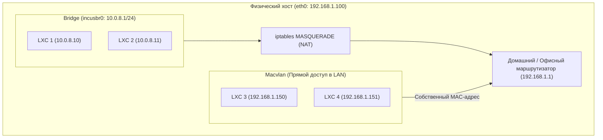

# Урок 3: Сетевой стек системных контейнеров: Bridge, Macvlan, проброс портов и статические IP

В отличие от Docker, где сетевая изоляция жестко завязана на внутренний bridge и цепочки iptables `DOCKER`, в **LXC / Incus** системный контейнер ведет себя как полноценный сетевой хост. Ему можно выдать реальный физический MAC-адрес, подключить напрямую к локальной сети маршрутизатора или изолировать в виртуальном мосте.

В этом уроке мы разберем:
1. **Сетевые драйверы Incus/LXC**:
   - `bridge` (управляемый мост `incusbr0` с NAT, DHCP и DNS).
   - `macvlan` и `ipvlan`: получение реального IP из физической локальной сети без NAT.
   - `routed` и `physical`: прямое назначение сетевых карт и SR-IOV.
2. **Проброс портов с помощью `proxy`-устройств**: как публиковать порты веб-сервисов и баз данных без прямого редактирования iptables.
3. **Фиксация статических IP-адресов**: назначение постоянного IP через параметры демона и через `netplan`/`systemd-networkd`.
4. **Сетевая изоляция и фильтрация трафика** средствами ядра Linux.

---

## 1. Сетевые топологии: Bridge vs Macvlan



### Сравнение сетевых типов:

| Сетевой тип | Свой MAC-адрес | Нужен ли NAT на хосте? | Доступен ли из физической LAN? | Общение хоста с контейнером |
|---|---|---|---|---|
| **`bridge` (`incusbr0`)** | Да (виртуальный) | Да (MASQUERADE) | Только через проброс портов (`proxy`) | Да (напрямую) |
| **`macvlan`** | Да (уникальный) | **Нет** | **Да (напрямую, как отдельный ПК)** | **Нет** (ограничение ядра Linux, нужен shim) |
| **`ipvlan` (l2/l3)** | Нет (общий MAC хоста) | Нет | Да | Да |
| **`routed`** | Нет | Нет (статическая маршрутизация) | Через статический маршрут | Да |
| **`physical`** | Физический | Нет | Да (монопольный захват порта) | Зависит от карты |

---

## 2. Управляемый мост `incusbr0` (Managed Bridge)

По умолчанию при `incus admin init` создается мост `incusbr0`.
Демон Incus автоматически поднимает встроенный легковесный сервер `dnsmasq`, обеспечивающий:
1. Выдачу IPv4 и IPv6 адресов по DHCP.
2. Автоматическое разрешение DNS-имен: любой контейнер доступен по имени `<имя_контейнера>.incus` (например, `ping db-master.incus`).

### Просмотр и настройка моста:
```bash
# Список всех сетей
incus network list

# Подробная конфигурация incusbr0
incus network show incusbr0
```

---

## 3. Назначение статического IP-адреса

### Способ 1: Привязка через DHCP Incus (Рекомендуемый)
Incus связывает постоянный статический IP-адрес с сетевым интерфейсом контейнера:

```bash
# Закрепляем за контейнером srv-db адрес 10.0.8.50 в сети incusbr0:
incus config device set srv-db eth0 ipv4.address 10.0.8.50

# Перезапуск сетевого стека контейнера:
incus restart srv-db
```
После перезапуска `srv-db` всегда будет получать адрес `10.0.8.50`.

### Способ 2: Статический IP внутри гостевой ОС (`netplan` для Ubuntu)
Внутри контейнера можно переопределить конфигурацию `/etc/netplan/10-static.yaml`:
```yaml
network:
  version: 2
  ethernets:
    eth0:
      dhcp4: false
      addresses:
        - 10.0.8.50/24
      routes:
        - to: default
          via: 10.0.8.1
      nameservers:
        addresses: [10.0.8.1, 1.1.1.1]
```
Применение: `netplan apply`.

---

## 4. Проброс портов с помощью `proxy`-устройств

В Docker для публикации порта используется `-p 8080:80`. В Incus для этого существует механизм виртуальных устройств типа **`proxy`**, который работает на уровне TCP/UDP сокетов хоста или через нативный iptables/nftables.

### Пример 1: Проброс веб-сервера (порт 80 и 443)
```bash
# Добавляем устройство http-in: слушать 0.0.0.0:80 на хосте и пересылать в 127.0.0.1:80 контейнера
incus config device add web-server http-in proxy \
  listen=tcp:0.0.0.0:80 \
  connect=tcp:127.0.0.1:80 \
  bind=host

# Добавляем проброс SSL HTTPS:
incus config device add web-server https-in proxy \
  listen=tcp:0.0.0.0:443 \
  connect=tcp:127.0.0.1:443 \
  bind=host
```

### Пример 2: Сохранение реального IP-клиента (PROXY Protocol)
Когда трафик проксируется, приложение видит IP хоста (`127.0.0.1`). Если добавить параметр `nat=true`, Incus использует правила ядра DNAT, сохраняя оригинальный IP клиента:
```bash
incus config device set web-server http-in nat true
```

---

## 5. Подключение к физической локальной сети через `macvlan`

Если вам нужно, чтобы системный контейнер получил IP-адрес `192.168.1.150` прямо от вашего домашнего Wi-Fi роутера или офисного DHCP-сервера:

```bash
# 1. Создаем сетевой профиль macvlan, привязанный к физической сетевой карте хоста (например enp3s0)
incus profile create lan-direct
incus profile device add lan-direct eth0 nic \
  nictype=macvlan \
  parent=enp3s0

# 2. Запускаем контейнер с новым профилем:
incus launch images:ubuntu/24.04 nas-server -p default -p lan-direct
```
Контейнер `nas-server` отправит широковещательный DHCP-запрос в физическую сеть и появится в списке клиентов вашего роутера как отдельный физический компьютер со своим уникальным MAC-адресом!

> [!CAUTION]
> **Нюанс Macvlan в ядре Linux**: по соображениям безопасности ядро запрещает прямой сетевой обмен между физическим хостом и запущенным на нем macvlan-контейнером. Соседние компьютеры в сети увидят контейнер, а сам хост — нет (для решения этой задачи создается macvlan-интерфейс на самом хосте).

---

## 6. Лабораторная работа

1. Запустите системный контейнер `web-lab`:
```bash
incus launch images:ubuntu/24.04 web-lab
```
2. Установите внутри контейнера `nginx`:
```bash
incus exec web-lab -- apt update
incus exec web-lab -- apt install -y nginx
```
3. Пробросьте порт 8088 хоста на порт 80 контейнера:
```bash
incus config device add web-lab test-web proxy \
  listen=tcp:0.0.0.0:8088 \
  connect=tcp:127.0.0.1:80 \
  bind=host
```
4. Выполните проверку доступности с хоста через опубликованный порт:
```bash
curl -I http://localhost:8088
```
Убедитесь в получении ответа `HTTP/1.1 200 OK`.
5. Посмотрите список подключенных устройств контейнера:
```bash
incus config device show web-lab
```
6. Удалите прокси-устройство и тестовый контейнер:
```bash
incus config device remove web-lab test-web
incus stop web-lab && incus delete web-lab
```
