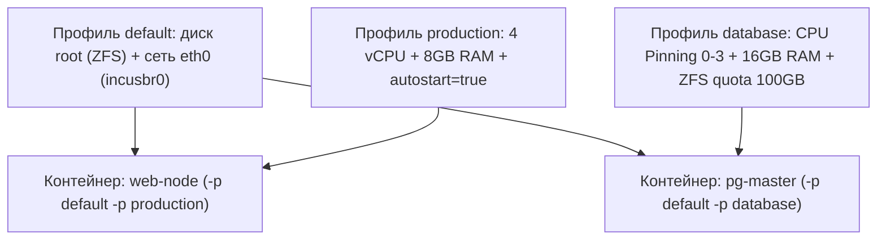

# Урок 4: Профили конфигурации (Profiles), Cgroups лимиты ресурсов и автозапуск системных контейнеров

В производственной среде системные контейнеры не настраиваются вручную по отдельности. Если вам требуется запустить 20 одинаково сконфигурированных узлов кластера (например, воркеров Kubernetes, реплик базы данных или узлов сборки), в **LXC / Incus** применяется механизм **Профилей (Profiles)**.

В этом уроке мы разберем:
1. **Архитектура профилей**: наследование, объединение и переопределение настроек (слои `default` → `production` → кастомный контейнер).
2. **Управление ресурсами через Cgroups v2**:
   - Ограничение ядер процессора (`limits.cpu`) и CPU Pinning (привязка процессов к физическим ядрам процессора).
   - Квоты процессорного времени (`limits.cpu.allowance: 50%`) и приоритеты.
   - Жесткие и мягкие лимиты оперативной памяти (`limits.memory`, `limits.memory.enforce: hard`, swap control).
3. **Автозапуск системных контейнеров при загрузке хоста**:
   - `boot.autostart: true`.
   - Приоритеты запуска (`boot.autostart.priority`) для корректной последовательности (СУБД → Бэкенд → Прокси).
   - Защита от «I/O шторма» при перезагрузке сервера через `boot.autostart.delay`.

---

## 1. Архитектура Профилей (Profiles) в Incus

Профиль — это именованный набор параметров конфигурации и виртуальных устройств (диски, сетевые карты, лимиты), который можно применять к любому количеству контейнеров.



> [!NOTE]
> Контейнер может наследовать несколько профилей одновременно. Приоритет отдается профилю, указанному последним в списке, а точечные параметры самого контейнера перекрывают любые значения из профилей.

### Управление профилями через CLI:
```bash
# Список всех профилей
incus profile list

# Просмотр параметров профиля default
incus profile show default

# Создание нового профиля
incus profile create prod-worker
```

---

## 2. Cgroups v2: Управление CPU и памятью

В отличие от KVM-виртуализации, где выделение 8 ядер жестко резервирует ресурсы, в системных контейнерах Cgroups v2 обеспечивает гибкое распределение: неиспользуемые контейнером такты CPU доступны другим процессам хоста.

### 1. Ограничение количества ядер CPU:
```bash
# Выделить контейнеру ровно 4 виртуальных ядра:
incus config set srv-app limits.cpu 4
```

### 2. CPU Pinning (Привязка к конкретным ядрам процессора):
Для высоконагруженных баз данных (PostgreSQL, ClickHouse) переключение контекста между разными физическими ядрами и NUMA-узлами вызывает падение производительности кэша L3. Привязка к конкретным ядрам устраняет эту проблему:
```bash
# Зафиксировать контейнер строго на физических ядрах 0, 1, 2 и 3:
incus config set pg-master limits.cpu "0,1,2,3"
```

### 3. Квоты процессорного времени (CPU Allowance):
Если контейнеру выделено 2 ядра, но вы хотите, чтобы он использовал не более 50% мощности этих ядер:
```bash
# Ограничить утилизацию CPU до 50%
incus config set srv-app limits.cpu.allowance 50%

# Либо задать явный квант времени CFS (Completely Fair Scheduler): 25ms каждые 50ms:
incus config set srv-app limits.cpu.allowance 25ms/50ms
```

### 4. Ограничение оперативной памяти (RAM) и Swap:
```bash
# Установить жесткий лимит 4 ГБ:
incus config set srv-app limits.memory 4GiB

# Включить жесткий режим (Hard Enforcement): при исчерпании лимита OOM-killer сработает внутри cgroup:
incus config set srv-app limits.memory.enforce hard

# Запретить контейнеру использовать Swap хоста:
incus config set srv-app limits.memory.swap false
```

---

## 3. Автозапуск и предотвращение «I/O шторма» при перезагрузке сервера

Когда сервер с 30 системными контейнерами перезагружается (например, после обновления ядра хоста), одновременный старт всех ОС создает колоссальную нагрузку на дисковую подсистему и процессор — так называемый **I/O Storm**.

Incus решает эту задачу с помощью системы приоритетов и задержек:

### 1. Включение автозапуска:
```bash
# Контейнер запустится автоматически вместе со службой Incus
incus config set pg-master boot.autostart true
```

### 2. Приоритеты последовательности запуска (`boot.autostart.priority`):
Чем выше числовое значение, тем раньше запустится контейнер.

* СУБД (PostgreSQL / Redis): `priority: 100` (стартует первой).
* Бэкенд-сервисы (API / Workers): `priority: 50` (стартует после СУБД).
* Веб-прокси (Nginx / HAProxy): `priority: 10` (стартует последним, когда все сервисы готовы).

```bash
incus config set pg-master boot.autostart.priority 100
incus config set api-service boot.autostart.priority 50
incus config set web-proxy boot.autostart.priority 10
```

### 3. Задержка между запусками (`boot.autostart.delay`):
Чтобы СУБД успела инициализироваться и прочитать данные с диска до старта бэкенда, задается задержка в секундах:
```bash
# Подождать 15 секунд после старта pg-master перед запуском следующего по приоритету контейнера:
incus config set pg-master boot.autostart.delay 15
```

---

## 4. Практика: Создание готового продакшен-профиля

Создадим профиль `prod-db` и применим его к новому контейнеру:

```bash
# 1. Создаем профиль
incus profile create prod-db

# 2. Настраиваем лимиты и автозапуск в профиле
incus profile set prod-db limits.cpu 2
incus profile set prod-db limits.memory 2GiB
incus profile set prod-db limits.memory.enforce hard
incus profile set prod-db boot.autostart true
incus profile set prod-db boot.autostart.priority 90
incus profile set prod-db boot.autostart.delay 10

# 3. Запускаем контейнер с наследованием default (диск + сеть) и prod-db (лимиты):
incus launch images:ubuntu/24.04 my-production-db -p default -p prod-db

# 4. Проверяем примененные лимиты внутри контейнера:
incus exec my-production-db -- nproc
incus exec my-production-db -- free -h
```
Команда `nproc` вернет `2`, а `free -h` покажет ровно `2.0Gi` доступной памяти!

---

## 5. Лабораторная работа

1. Создайте профиль `lab-limits`:
```bash
incus profile create lab-limits
incus profile set lab-limits limits.cpu 1
incus profile set lab-limits limits.memory 512MiB
incus profile set lab-limits limits.memory.enforce hard
```
2. Запустите тестовый контейнер `limit-test` с профилем `lab-limits`:
```bash
incus launch images:alpine/3.20 limit-test -p default -p lab-limits
```
3. Проверьте количество ядер и объем памяти:
```bash
incus exec limit-test -- grep -c ^processor /proc/cpuinfo
incus exec limit-test -- free -m
```
4. Измените лимит памяти «на лету» без перезагрузки контейнера:
```bash
incus config set limit-test limits.memory 1GiB
incus exec limit-test -- free -m
```
Убедитесь, что объем оперативной памяти увеличился мгновенно.
5. Настройте автозапуск контейнера:
```bash
incus config set limit-test boot.autostart true
incus config set limit-test boot.autostart.priority 50
```
6. Удалите лабораторный стенд:
```bash
incus stop limit-test && incus delete limit-test
incus profile delete lab-limits
```
