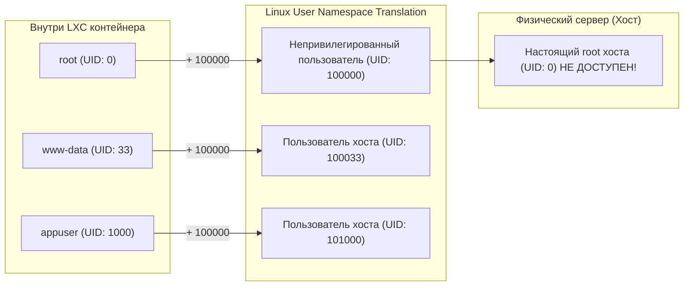

# Урок 5: Безопасность системных контейнеров: Unprivileged режим, UID маппинг и Docker внутри LXC

Главный страх при использовании контейнеризации — побег из контейнера (Container Breakout). Если злоумышленник скомпрометирует процесс внутри контейнера, получит ли он доступ к физическому серверу?

В системных контейнерах **LXC / Incus** безопасность возведена в абсолют благодаря нативным **User Namespaces** ядра Linux и непривилегированному режиму (**Unprivileged Containers**).

В этом уроке мы разберем:
1. **Привилегированные vs Непривилегированные контейнеры**: почему `security.privileged: false` включен по умолчанию и почему запуск в `privileged`-режиме считается критической уязвимостью.
2. **Как работает маппинг UID/GID (`/etc/subuid` и `/etc/subgid`)**: почему root внутри контейнера (UID 0) на хосте является непривилегированным пользователем `100000`.
3. **Nesting: запуск Docker внутри LXC (Docker-in-LXC)**: почему без флагов `security.nesting` Docker не может смонтировать `overlayfs` и как правильно настроить вложенную контейнеризацию.
4. **Проброс аппаратных устройств (Hardware Passthrough)**: прямое подключение GPU (NVIDIA CUDA / Intel QuickSync) и USB-устройств без накладных расходов.

---

## 1. Unprivileged Containers: Маппинг UID и защита от побега

В обычном Docker по умолчанию контейнеры привилегированы по пользователю: root внутри контейнера имеет `UID 0` на самом хосте. Если уязвимость в ядре позволит процессу выйти за пределы chroot/pivot_root, злоумышленник мгновенно станет root на всем сервере.

В **LXC / Incus** все контейнеры по умолчанию **Unprivileged (Непривилегированные)**.



### Файлы `/etc/subuid` и `/etc/subgid`
Ядро Linux выделяет диапазоны субидентификаторов для демона Incus:
```
root:100000:1000000000
incus:100000:1000000000
```
Это означает:
* Пользователь `root` (UID 0) внутри контейнера для ядра хоста является процессом с `UID 100000`.
* Даже если процесс сбежит из контейнера, у него не будет прав даже прочитать файл `/etc/shadow` на хосте!

> [!CAUTION]
> Никогда не включайте `security.privileged: true` без крайней необходимости. Этот флаг отключает изоляцию пользователей, приравнивая `UID 0` контейнера к `UID 0` физического сервера.

---

## 2. Docker внутри LXC (Nesting / Docker-in-LXC)

Одна из самых популярных архитектур в DevOps — запуск полноценного Docker-демона или Kubernetes-узла (k3s, kubeadm) внутри легковесного системного контейнера LXC. Это позволяет каждому разработчику или CI-раннеру выдать изолированную «песочницу», где он может свободно запускать `docker build` и `docker compose`, не имея доступа к физическому серверу.

### Почему Docker «из коробки» не работает в LXC?
При попытке запустить Docker внутри неконфигурированного LXC вы получите ошибки:
* `mount: permission denied` (ядро блокирует монтирование `overlayfs` и `cgroupfs` внутри unprivileged user namespace).
* `mknod: operation not permitted` (запрет создания файлов блочных и символьных устройств).

### Решение: Включение Nesting и системных перехватов

Для контейнера `ci-worker` включаются специальные параметры безопасности:

```bash
# 1. Разрешаем вложенную виртуализацию и монтирование cgroups:
incus config set ci-worker security.nesting true

# 2. Включаем перехват и эмуляцию системных вызовов mknod ядра:
incus config set ci-worker security.syscalls.intercept.mknod true

# 3. Разрешаем эмуляцию монтирования файловых систем (overlayfs / ext4 / fuse):
incus config set ci-worker security.syscalls.intercept.setxattr true
```

### Проверка работы:
Зайдем внутрь контейнера и проверим работу Docker:
```bash
incus exec ci-worker -- bash

# Внутри LXC:
apt update && apt install -y docker.io
docker run --rm hello-world
```
Контейнер `hello-world` запустится внутри Docker, который запущен внутри LXC — со 100% изоляцией и нативной скоростью!

---

## 3. Проброс аппаратных устройств (Hardware & GPU Passthrough)

Системным контейнерам часто требуется прямой доступ к физическому оборудованию:
* **GPU NVIDIA**: для обучения нейросетей (PyTorch, TensorFlow, CUDA), транскодинга видео (FFmpeg, Plex) или запуска LLM (Ollama).
* **Intel GPU (QuickSync)**: для аппаратного ускорения видео через `/dev/dri`.
* **USB-устройства**: ключи защиты (Рутокен, eToken), Zigbee/Z-Wave адаптеры для Home Assistant.

### Проброс NVIDIA GPU:
Благодаря драйверу `gpu` в Incus видеокарта пробрасывается одной командой без необходимости перезагрузки и без прошивки PCI:

```bash
# Пробросить первую попавшуюся GPU хоста в контейнер ai-worker:
incus config device add ai-worker my-gpu gpu

# Пробросить конкретную видеокарту по её PCI-адресу:
incus config device add ai-worker my-gpu gpu pci=0000:01:00.0
```
Внутри контейнера команда `nvidia-smi` мгновенно определит видеокарту и драйвер!

### Проброс дисковых накопителей или папок хоста:
```bash
# Смонтировать физический SSD /mnt/data хоста в папку /var/data контейнера:
incus config device add srv-app data-mount disk source=/mnt/data path=/var/data
```

---

## 4. Комплексный боевой профиль `docker-host`

Объединим все требования в один переиспользуемый профиль `docker-host`:

```bash
incus profile create docker-host
incus profile set docker-host security.nesting true
incus profile set docker-host security.syscalls.intercept.mknod true
incus profile set docker-host security.syscalls.intercept.setxattr true
incus profile set docker-host limits.cpu 4
incus profile set docker-host limits.memory 8GiB
```

Теперь любой инженер может одной командой поднять изолированный сервер под Docker-проекты:
```bash
incus launch images:ubuntu/24.04 my-docker-env -p default -p docker-host
```

---

## 5. Лабораторная работа

1. Запустите системный контейнер `nest-lab` с включенным режимом Nesting:
```bash
incus launch images:ubuntu/24.04 nest-lab \
  -c security.nesting=true \
  -c security.syscalls.intercept.mknod=true
```
2. Проверьте числовые UID процессов на хосте:
```bash
# Узнаем PID контейнера на хосте
PID=$(incus info nest-lab | grep "PID:" | awk '{print $2}')
# Проверим реальный UID процесса в /proc
grep Uid /proc/$PID/status
```
Убедитесь, что реальный `Uid` на хосте равен `100000`, а не `0`.
3. Установите Docker внутри контейнера:
```bash
incus exec nest-lab -- apt update
incus exec nest-lab -- apt install -y docker.io
```
4. Запустите тестовый прикладной контейнер внутри системного:
```bash
incus exec nest-lab -- docker run --rm alpine uname -a
```
5. Удалите лабораторный стенд:
```bash
incus stop nest-lab && incus delete nest-lab
```
