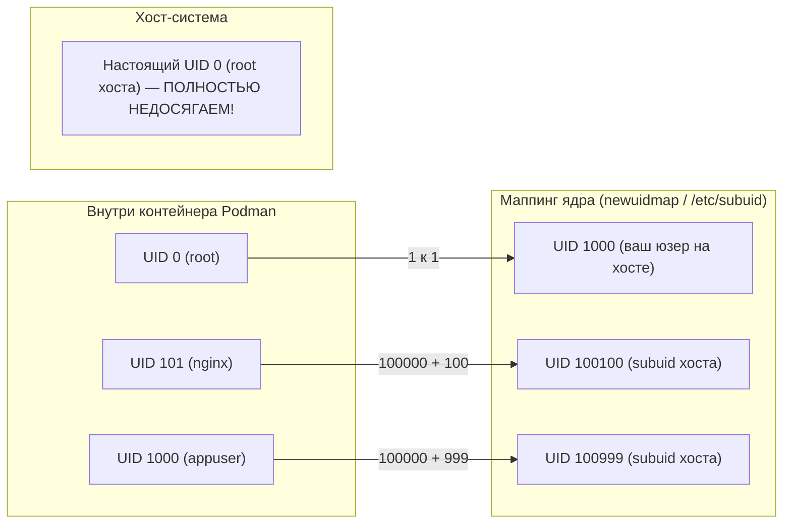

# Урок 1: Архитектура Podman: Daemonless, Conmon, User Namespaces и Rootless Networking

Исторически Docker строился вокруг централизованного демона `dockerd`, работающего с наивысшими привилегиями `root`. Это создавало критическую проблему безопасности: любой пользователь, добавленный в группу `docker`, де-факто получал полные root-права на физическом сервере через монтирование сокета `/var/run/docker.sock`. Падение демона приводило к сбою всех запущенных контейнеров (Single Point of Failure).

Инженеры Red Hat полностью переосмыслили архитектуру контейнеризации, создав **Podman (Pod Manager)** — бескомпромиссный стандарт контейнеризации для Enterprise Linux (RHEL, Fedora, CentOS Stream), работающий **без демона** и **без root-привилегий**.

В этом уроке мы разберем:
1. **Daemonless vs Daemon**: архитектурное сравнение с Docker, роль легковесного супервизора `conmon` и скоростного C-рантайма `crun`.
2. **Как работает Rootless на уровне ядра**: User Namespaces, трансляция идентификаторов и настройка `/etc/subuid` и `/etc/subgid`.
3. **Сетевой стек Rootless**: почему обычный пользователь не может создать сетевой мост и как работают драйверы `pasta` и `slirp4netns`.
4. **Решение проблемы привилегированных портов (< 1024)**: параметр ядра `net.ipv4.ip_unprivileged_port_start`.
5. **Совместимость с Docker**: эмуляция сокета `podman.socket` и поддержка стандартных OCI-инструментов.

---

## 1. Сравнение архитектур: Docker vs Podman

Главное отличие Podman от Docker — отсутствие промежуточного фонового демона. Podman использует классическую для UNIX модель **Fork-Exec**: контейнер является прямым дочерним процессом команды запуска.

```mermaid
flowchart TD
    subgraph DockerModel ["Архитектура Docker (Daemon-centric)"]
        DCLI["docker CLI (Client)"] -->|"REST API / UNIX Socket"| DD["dockerd (Root Daemon, SPOF)"]
        DD --> CD["containerd"]
        CD --> R1["containerd-shim"]
        R1 --> RC1["runc"]
        RC1 --> P1["App Container Process"]
    end

    subgraph PodmanModel ["Архитектура Podman (Daemonless & Rootless)"]
        PCLI["podman CLI (Fork/Exec)"] --> CM["conmon (C-супервизор ~2MB RAM)"]
        CM --> CR["crun / runc (OCI Runtime)"]
        CR --> P2["App Container Process (UID 1000)"]
    end
```



### Преимущества архитектуры Podman:
1. **Нет единой точки отказа (No SPOF)**: если упадет или обновится CLI Podman, контейнеры продолжат работать без единого прерывания.
2. **Истинный аудит Linux (Auditd)**: в Docker системный журнал `auditd` видит все действия так, будто их совершил демон `dockerd` от имени `root`. В Podman ядро точно фиксирует реального пользователя (UID), запустившего контейнер.
3. **Легковесный супервизор `conmon`**: написан на чистом C, потребляет всего 1–2 МБ памяти, перехватывает `stdout`/`stderr`, следит за кодами выхода (exit codes) и передает логи в journald/syslog.
4. **Рантайм `crun`**: современный OCI-рантайм на C, работающий в разы быстрее классического `runc` на Go и с нативной поддержкой cgroups v2.

---

## 2. Физика Rootless: User Namespaces и файлы `subuid`/`subgid`

Rootless означает, что контейнеры создаются и управляются пользователем без `sudo` и без членства в привилегированных группах.

Для этого ядро Linux задействует **User Namespaces** (пространства имен пользователей):
* Внутри контейнера процесс видит себя как `root` (UID 0), поэтому команды `apt install`, `apk add` и смена прав `chown` работают без ошибок.
* Для ядра хоста этот процесс является обычным непривилегированным пользователем (например UID 1000) и набором выделенных субидентификаторов.



### Конфигурация `/etc/subuid` и `/etc/subgid`
Для каждого пользователя системы задается диапазон подчиненных ID (обычно 65 536 идентификаторов):
```bash
cat /etc/subuid
# devuser:100000:65536
```
Это означает:
- UID 0 внутри контейнера транслируется в ваш реальный UID (например, 1000).
- UID 1–65535 транслируются в диапазон хоста `100000–165535`.

> [!IMPORTANT]
> Если злоумышленник найдет уязвимость в приложении и сбежит из контейнера на хост, он окажется пользователем с UID 100000. У него не будет доступа ни к конфигурациям системы, ни к файлам других пользователей, ни к памяти ядра.

---

## 3. Сетевой стек Rootless: Pasta vs Slirp4netns

Непривилегированный пользователь в Linux не имеет права создавать сетевые интерфейсы типа bridge или изменять таблицы маршрутизации ядра (`iptables`/`nftables`). Как в таком случае Podman обеспечивает контейнерам доступ в сеть и проброс портов?

В пространстве пользователя трафик упаковывается через специальный эмулятор сетевого стека:

```
┌───────────────────────────────────────┐
│     Контейнер (eth0: 10.0.2.100)      │
└───────────────────┬───────────────────┘
                    │ UNIX Domain Socket / tap
                    ▼
┌───────────────────────────────────────┐
│  pasta (по умолчанию) / slirp4netns   │  <-- Работает в userspace от вашего UID
└───────────────────┬───────────────────┘
                    │ Стандартные сокетные вызовы (connect / bind)
                    ▼
┌───────────────────────────────────────┐
│      Сетевая карта хоста (eth0)       │
└───────────────────────────────────────┘
```

### Сравнение сетевых бэкендов:
* **`pasta` (Pack A Subtle Tap Abstraction)**: современный бэкенд по умолчанию в Podman 5+. Передает сокеты напрямую без лишнего копирования пакетов между userspace и ядром. Скорость близка к нативной пропускной способности сети хоста.
* **`slirp4netns`**: проверенный временем классический бэкенд для старых ядер Linux. Имеет небольшие накладные расходы по CPU при интенсивном трафике (гигабитные потоки).

---

## 4. Публикация портов и решение проблемы портов < 1024

По стандарту POSIX/Linux порты ниже `1024` (80 HTTP, 443 HTTPS, 53 DNS, 22 SSH) считаются привилегированными — их может слушать только `root`.

Если запустить контейнер от обычного пользователя с маппингом порта 80:
```bash
podman run -d -p 80:80 nginx:alpine
# Ошибка: rootlessport: cannot expose privileged port 80, you might need to add "net.ipv4.ip_unprivileged_port_start=80"
```

### Решение: Тюнинг sysctl ядра Linux
Чтобы разрешить непривилегированным пользователям открывать веб-порты начиная с 80:

```bash
# Временное применение (до перезагрузки):
sudo sysctl -w net.ipv4.ip_unprivileged_port_start=80

# Постоянное сохранение в системе:
echo "net.ipv4.ip_unprivileged_port_start=80" | sudo tee /etc/sysctl.d/99-rootless-ports.conf
sudo sysctl --system
```
После этого команда `podman run -d -p 80:80 nginx:alpine` выполнится успешно!

---

## 5. Эмуляция Docker API (podman.socket)

Многие сторонние утилиты (Docker Compose, Testcontainers в Java/Go, CI-агенты, IDE) ожидают наличия UNIX-сокета Docker API `/var/run/docker.sock`.

Podman умеет предоставлять полностью совместимый REST API без единого root-процесса через пользовательский `systemd`-сокет:

```bash
# Включение сокета Podman для текущего пользователя:
systemctl --user enable --now podman.socket

# Проверка сокета:
ls -la $XDG_RUNTIME_DIR/podman/podman.sock
# /run/user/1000/podman/podman.sock

# Экспорт переменной для Docker CLI и библиотек:
export DOCKER_HOST="unix://$XDG_RUNTIME_DIR/podman/podman.sock"

# Проверка: стандартная команда docker теперь общается с Podman!
docker ps
```

---

## 6. Лабораторная работа

1. Убедитесь, что для вашего пользователя настроены подчиненные идентификаторы:
```bash
grep $USER /etc/subuid
grep $USER /etc/subgid
```
2. Запустите rootless-контейнер Alpine и сравните видимый UID внутри и снаружи:
```bash
podman run -d --name test-uid alpine sleep 300
# Проверяем внутри контейнера:
podman top test-uid user huser
# В выводе: user=root, huser=<ваш_логин_на_хосте>
```
3. Проверьте сетевой стек `pasta`:
```bash
podman run --rm alpine ip addr show
```
Обратите внимание на выданный виртуальный интерфейс.
4. Проверьте работу сопоставления файлов:
```bash
touch /tmp/host-file.txt
podman run --rm -v /tmp/host-file.txt:/data.txt:Z alpine ls -l /data.txt
podman rm -f test-uid
```
5. Активируйте пользовательский сокет `podman.socket` и проверьте получение информации через `curl`:
```bash
systemctl --user enable --now podman.socket
curl -s --unix-socket $XDG_RUNTIME_DIR/podman/podman.sock http://d/v4.0.0/libpod/info | grep -o '"version":[^,]*'
```
