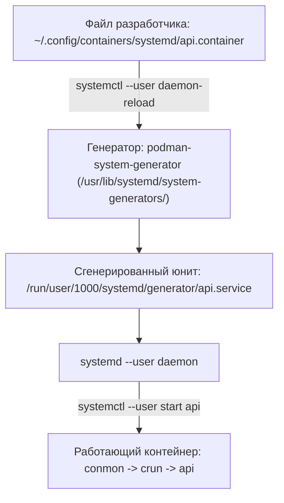

# Урок 2: Декларативное управление через Quadlet: контейнеры как нативные службы systemd

В традиционном Docker для автозапуска и оркестрации контейнеров на одном сервере используется `docker compose` либо флаг `--restart always`. Однако этот подход создает дополнительную прослойку и не интегрируется с менеджером служб самой операционной системы — **systemd**.

В Podman 4.4+ компания Red Hat представила революционный инструмент — **Quadlet**. Он позволяет описывать контейнеры в декларативных конфигурационных файлах, которые генератор systemd автоматически компилирует в полноценные нативные `*.service` юниты.

В этом уроке мы разберем:
1. **Почему Quadlet заменил устаревший `podman generate systemd`**: динамическая генерация против статичных скриптов.
2. **Анатомия Quadlet**: расположение файлов (`~/.config/containers/systemd/`), типы юнитов (`.container`, `.volume`, `.network`, `.kube`).
3. **Синтаксис `.container` файлов**: разбор директив секций `[Unit]`, `[Container]`, `[Service]`, `[Install]`.
4. **Непрерывная работа без активной SSH-сессии**: настройка **Linger** (`loginctl enable-linger`).
5. **Автоматическое обновление образов без простоя**: таймер `podman-auto-update.timer` и директива `AutoUpdate=registry`.
6. **Практический пример**: декларативный запуск микросервиса с томом и сетью через `systemctl --user`.

---

## 1. Эволюция: от `podman generate systemd` к Quadlet

Раньше для автозапуска контейнеров инженеры запускали контейнер вручную через CLI, а затем выполняли `podman generate systemd --name my-app > ~/.config/systemd/user/my-app.service`.

У этого метода были серьезные недостатки:
- Громоздкие сгенерированные файлы с жестко зашитыми CLI-флагами `podman run`.
- Невозможность декларативно обновить образ или порты: приходилось удалять контейнер, удалять unit-файл и генерировать всё заново.
- Риск расхождения (Drift) между работающим контейнером и файлом службы.

**Quadlet** решает эту проблему в корне: вы пишете простой файл в стиле `INI/systemd`. При выполнении `systemctl daemon-reload` генератор **`podman-system-generator`** автоматически преобразует ваш файл в юнит systemd на лету!



---

## 2. Где размещаются файлы Quadlet?

Quadlet поддерживает как общесистемные службы (root), так и rootless-службы непривилегированных пользователей:

| Тип служб | Путь каталога | Область управления |
|---|---|---|
| **Пользовательские (Rootless)** | `~/.config/containers/systemd/` | `systemctl --user ...` (рекомендуется) |
| **Общесистемные (Root)** | `/etc/containers/systemd/` | `sudo systemctl ...` |

### Поддерживаемые типы файлов Quadlet:
* **`.container`** — описание запуска контейнера (замена `podman run`).
* **`.volume`** — создание именованного тома (замена `podman volume create`).
* **`.network`** — создание изолированной сети (замена `podman network create`).
* **`.kube`** — запуск готового Kubernetes YAML манифеста (замена `podman kube play`).
* **`.image`** — декларативная гарантия предзагрузки образа из реестра.

---

## 3. Анатомия файла `.container`

Создадим файл `~/.config/containers/systemd/web-app.container`:

```ini
[Unit]
Description=Production Web Application Container
After=network-online.target
Wants=network-online.target

[Container]
# Образ из OCI реестра
Image=docker.io/library/nginx:alpine
ContainerName=web-app

# Публикация портов хост:контейнер
PublishPort=8080:80

# Подключение именованного тома или bind mount
Volume=web-data.volume:/usr/share/nginx/html:ro

# Подключение сети
Network=app-net.network

# Переменные окружения
Environment=ENV=production
Environment=LOG_LEVEL=info

# Автоматическое обновление при появлении нового тега в реестре
AutoUpdate=registry

# Лимиты ресурсов через cgroups v2
Memory=512M

[Service]
# Автоматический перезапуск systemd при падении процесса
Restart=always
TimeoutStartSec=300

[Install]
# Запуск при старте сессии пользователя
WantedBy=default.target
```

### Разбор ключевых секций:
* **`[Unit]`**: стандартная секция systemd. Позволяет задавать зависимости (например, `After=postgres.service`, чтобы веб-сервер ждал базу данных).
* **`[Container]`**: специализированная секция Quadlet. Каждая строчка соответствует аргументу команды `podman run`, но в удобном декларативном синтаксисе.
* **`[Service]`**: параметры поведения службы systemd (`Restart=always`, задержки, тайм-ауты).
* **`[Install]`**: привязка к таргету автозапуска (`default.target`).

---

## 4. Фоновая работа без SSH: Настройка Linger

В Linux по умолчанию пользовательский менеджер `systemd --user` запускается в момент входа по SSH и **убивает все процессы пользователя при выходе** (logout).

Чтобы контейнеры продолжали работать круглосуточно, как системные демоны, необходимо активировать режим **Linger**:

```bash
# Разрешить запуск и работу systemd пользователя без активного входа:
loginctl enable-linger $USER

# Проверка статуса linger:
loginctl show-user $USER --property=Linger
# Вывод: Linger=yes
```

> [!IMPORTANT]
> Без включения `linger` все ваши контейнеры Quadlet остановятся в ту же секунду, когда вы закроете терминал SSH!

---

## 5. Автоматическое обновление образов (Podman Auto-Update)

Одной из самых мощных возможностей связки Podman + Quadlet является нативное автообновление образов без сторонних утилит вроде Watchtower.

Если в `.container` файле указана директива:
```ini
AutoUpdate=registry
```
То встроенная служба Podman может автоматически проверять реестр, скачивать новый образ и плавно перезапускать юнит:

```bash
# Ручной запуск проверки и обновления всех сервисов с AutoUpdate=registry:
podman auto-update

# Активация встроенного ежедневного таймера systemd:
systemctl --user enable --now podman-auto-update.timer
```

Если новый образ не сможет запуститься (упадет при старте), systemd и Podman автоматически откатят запуск на предыдущий рабочий образ!

---

## 6. Управление службами Quadlet через `systemctl`

После добавления или редактирования любого `.container` файла необходимо дать команду systemd перегенерировать сервисы:

```bash
# 1. Перечитываем конфигурацию генераторов
systemctl --user daemon-reload

# 2. Запуск службы (имя службы совпадает с именем файла: web-app.container -> web-app.service)
systemctl --user start web-app.service

# 3. Проверка статуса (красивый нативный вывод systemd с PID, Cgroups и логами):
systemctl --user status web-app.service

# 4. Включение автозапуска при загрузке ОС:
systemctl --user enable web-app.service

# 5. Просмотр логов контейнера через стандартный journalctl:
journalctl --user -u web-app.service -f
```

---

## 7. Лабораторная работа

1. Включите режим Linger для вашей учетной записи:
```bash
loginctl enable-linger $USER
```
2. Создайте каталог для декларативных служб Quadlet:
```bash
mkdir -p ~/.config/containers/systemd/
```
3. Создайте простой тестовый сервис `lab-echo.container`:
```ini
cat <<'EOF' > ~/.config/containers/systemd/lab-echo.container
[Unit]
Description=Echo Service Test
After=network-online.target

[Container]
Image=docker.io/library/alpine:latest
ContainerName=lab-echo
Exec=sleep 3600
Restart=always

[Install]
WantedBy=default.target
EOF
```
4. Обновите конфигурацию systemd и запустите службу:
```bash
systemctl --user daemon-reload
systemctl --user start lab-echo.service
systemctl --user status lab-echo.service
```
5. Убедитесь, что контейнер отображается и в `systemctl`, и в CLI `podman ps`:
```bash
podman ps --filter name=lab-echo
```
6. Остановите и удалите лабораторную службу:
```bash
systemctl --user stop lab-echo.service
rm ~/.config/containers/systemd/lab-echo.container
systemctl --user daemon-reload
```
