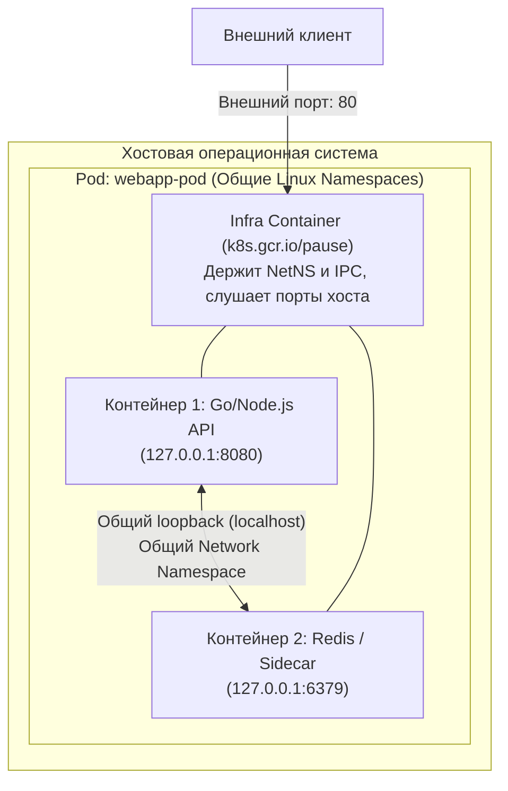

# Поды в Podman и интеграция с Kubernetes: от локальной разработки к K8s YAML

Исторически контейнеры ассоциировались с парадигмой Docker: «один контейнер — один процесс — одна виртуальная сеть». Однако в мире оркестрации де-факто стандартом стал **Kubernetes**, где базовой неделимой единицей развертывания является **Pod (Под)** — группа тесно связанных контейнеров, разделяющих общие сетевые и межпроцессные пространства имен.

Podman стал первым инструментом контейнеризации, который внедрил поддержку концепции **Pod на локальной машине без необходимости устанавливать кластер Kubernetes**. 

Более того, Podman позволяет двусторонне взаимодействовать с Kubernetes:
* Превращать запущенные локальные контейнеры в чистый декларативный **Kubernetes YAML** (`podman generate kube`).
* Запускать готовые Kubernetes YAML манифесты прямо на сервере или рабочей станции через **`podman kube play`**.

В этом уроке мы разберем:
1. **Анатомию пода на уровне ядра Linux**: роль инфра-контейнера (`infra/pause`), общие пространства имен (`netns`, `ipc`, `uts`, `pid`).
2. **Локальную работу с подами через Podman CLI**: объединение веб-приложения и кэша/базы данных через `localhost`.
3. **Генерацию Kubernetes-манифестов**: экспорт инфраструктуры с помощью `podman generate kube`.
4. **Бескластерный запуск манифестов**: `podman kube play` как легковесная альтернатива K3s, Minikube и Kind.
5. **Quadlet `.kube`**: запуск Kubernetes манифестов как нативных служб `systemd`.
6. **Сравнение подходов**: Docker Compose vs Podman Pods vs Kubernetes.

---

## 1. Анатомия пода в Podman: как это устроено в ядре Linux

Под в Podman — это не виртуальная машина и не отдельный тяжелый демон. Это группа OCI-контейнеров, объединенных общими пространствами имен Linux (Namespaces).



### Роль Infra Container (Инфра-контейнер)
Когда вы создаете под командой `podman pod create`, Podman первым делом запускает служебный **`infra container`** (минималистичный бинарник `pause` размером менее 1 МБ).

Зачем нужен инфра-контейнер:
1. **Хранение пространств имен**: Сетевой неймспейс (`netns`) и IPC неймспейс создаются именно для инфра-контейнера. Все остальные контейнеры пода просто подключаются к его неймспейсам (`--net=container:infra-id`).
2. **Привязка портов хоста**: Внешние порты (например, `-p 8080:80`) биндятся на инфра-контейнер при старте пода.
3. **Бесшовный перезапуск контейнеров приложения**: Если ваш бэкенд упал или перезагружается для обновления, сетевой интерфейс и открытый порт на хосте не исчезают, а сокеты не сбрасываются мгновенно, так как процесс `infra` продолжает жить.

По умолчанию в поде объединяются:
* **Network Namespace (`netns`)**: Контейнеры обращаются друг к другу через `localhost` (`127.0.0.1`), делят порты и сетевые интерфейсы.
* **IPC Namespace**: Разделяемая память (POSIX shared memory, семафоры).
* **UTS Namespace**: Общее имя хоста (hostname).

---

## 2. Практика: Управление подами через CLI

Рассмотрим связку из двух сервисов: **Nginx** (Reverse Proxy) и **Go Web App**. Им необходимо взаимодействовать без публикации промежуточных портов наружу.

### Шаг 1: Создание пода с публикацией внешнего порта
Порты пробрасываются именно на уровне пода, а не отдельных контейнеров!

```bash
podman pod create \
  --name webapp-pod \
  -p 8080:80 \
  --network bridge
```

Проверим созданный под:
```bash
podman pod ls
```
Вывод:
```text
POD ID        NAME        STATUS   CREATED         INFRA ID      # OF CONTAINERS
b8e4f1a23c91  webapp-pod  Created  10 seconds ago  d4b29a17ec1e  1
```
Обратите внимание: число контейнеров равно `1` — это и есть служебный `infra container`.

### Шаг 2: Добавление контейнеров внутрь пода

Запустим сервис базы данных/кэша Redis внутри пода:
```bash
podman run -d \
  --name pod-redis \
  --pod webapp-pod \
  docker.io/library/redis:alpine
```

Запустим микросервис, который общается с Redis через `localhost:6379`:
```bash
podman run -d \
  --name pod-backend \
  --pod webapp-pod \
  -e REDIS_ADDR=127.0.0.1:6379 \
  docker.io/library/nginx:alpine
```

> [!NOTE]
> В отличие от Docker Compose, где сервисы обращаются друг к другу по сетевым именам DNS (например, `redis:6379`), контейнеры внутри одного пода находятся на общем сетевом интерфейсе и связываются по **`127.0.0.1`** с максимальной производительностью без накладных расходов виртуального роутинга.

### Шаг 3: Управление жизненным циклом пода

Управлять всей связкой можно одной командой:
```bash
# Остановить все контейнеры пода
podman pod stop webapp-pod

# Запустить под целиком
podman pod start webapp-pod

# Просмотр процессов внутри пода
podman pod top webapp-pod

# Просмотр статистики потребления CPU/RAM всеми контейнерами пода
podman pod stats webapp-pod

# Удаление пода и всех его контейнеров
podman pod rm -f webapp-pod
```

---

## 3. `podman generate kube`: мост в Kubernetes

Одной из самых мощных возможностей Podman является генерация валидных спецификаций Kubernetes из работающих локальных подов или контейнеров.

Вы можете отладить работу микросервисов локально в Podman, а затем экспортировать готовую конфигурацию для Helm, ArgoCD или `kubectl`:

```bash
# Генерация манифеста K8s YAML для пода webapp-pod
podman generate kube webapp-pod > webapp-k8s.yaml
```

Посмотрим на сгенерированный манифест `webapp-k8s.yaml`:
```yaml
# Save the output of this file and use kubectl create -f to make
# authentic kubernetes resources.
apiVersion: v1
kind: Pod
metadata:
  labels:
    app: webapp-pod
  name: webapp-pod
spec:
  containers:
  - name: pod-redis
    image: docker.io/library/redis:alpine
    resources: {}
  - name: pod-backend
    image: docker.io/library/nginx:alpine
    env:
    - name: REDIS_ADDR
      value: 127.0.0.1:6379
    ports:
    - containerPort: 80
      hostPort: 8080
    resources: {}
```

### Генерация `Kind: Deployment`
По умолчанию генерируется ресурс `Kind: Pod`. Если вам нужен масштабируемый объект для продуктового кластера:
```bash
podman generate kube --type deployment --replicas 3 webapp-pod > deployment.yaml
```

Этот файл готов для немедленного применения в любой кластер:
```bash
kubectl apply -f deployment.yaml
```

---

## 4. `podman kube play`: запуск Kubernetes манифестов без кластера

Обратная операция — запуск стандартного Kubernetes YAML файла прямо на хосте под управлением Podman.

Вам больше не нужно устанавливать ресурсоемкие Minikube, K3s или Kind, если вам просто нужно протестировать манифест или запустить стек локально:

```bash
# Запуск пода по манифесту
podman kube play webapp-k8s.yaml
```

Что делает Podman в этот момент:
1. Читает YAML файл и парсит секции `spec.containers`, `ports`, `volumes`, `env`.
2. Автоматически создает локальный Podman Pod с инфра-контейнером.
3. Скачивает указанные OCI-образы и запускает контейнеры с заданными переменными окружения и монтированиями.

### Полезные флаги `podman kube play`:
* **`--down`** — корректно остановить и удалить все ресурсы, созданные манифестом (аналог `docker compose down`):
  ```bash
  podman kube play --down webapp-k8s.yaml
  ```
* **`--replace`** — удалить старый под и пересоздать его с нуля, если манифест обновился:
  ```bash
  podman kube play --replace webapp-k8s.yaml
  ```
* **`--network <имя>`** — подключить создаваемый под к определенной пользовательской сети Podman.

---

## 5. Декларативный запуск Kubernetes YAML через Quadlet (`.kube`)

Объединив **Quadlet** из Урока 2 и **Kubernetes YAML**, мы получаем мощнейший стек для production-серверов: приложение описано в стандартном K8s YAML, а управление его процессом, автозапуском и зависимостями берет на себя **systemd**.

Создадим файл службы Quadlet:
`~/.config/containers/systemd/webapp.kube`

```ini
[Unit]
Description=Production Webapp Pod via Kubernetes YAML
After=network-online.target
Wants=network-online.target

[Kube]
# Путь к Kubernetes YAML файлу
Yaml=%h/.config/containers/systemd/webapp-k8s.yaml

# Автоматически скачивать свежие образы из манифеста
AutoUpdate=registry

# Публикация портов хоста (если не переопределены в YAML)
PublishPort=8080:80

[Install]
WantedBy=default.target
```

Применяем изменения:
```bash
# Перечитываем конфигурацию systemd
systemctl --user daemon-reload

# Запускаем службу
systemctl --user start webapp

# Проверяем статус работы
systemctl --user status webapp

# Смотрим логи всех контейнеров пода в едином журнале
journalctl --user -u webapp -f
```

Systemd автоматически вызовет `podman kube play`, а при остановке службы (`systemctl --user stop webapp`) выполнит graceful-остановку всех контейнеров пода!

---

## 6. Сравнительная матрица: Docker Compose vs Podman Pods vs Kubernetes

| Критерий | Docker Compose v2 | Podman Pods (`kube play`) | Kubernetes / K3s |
|---|---|---|---|
| **Архитектура сети** | Изолированные контейнеры, обращение по DNS | Общий сетевой неймспейс (`localhost`) | Общий сетевой неймспейс (`localhost`) в поде |
| **Формат манифеста** | `docker-compose.yml` (проприетарный) | `k8s-pod.yaml` (стандарт Kubernetes) | `k8s.yaml` / CRD / Helm |
| **Потребление ресурсов** | Требуется root-демон dockerd | Минимальное (нет демона, легкий infra pause) | Высокое (etcd/kine, kubelet, apiserver) |
| **Интеграция с systemd** | Через костыли или `docker compose up -d` | Нативная через Quadlet `.kube` | Через kubelet daemon |
| **Переносимость в облако** | Требуется переписывать под K8s | Готов к деплою в K8s без изменений | 100% совместимость |

---

## Резюме урока

1. **Pod** в Podman объединяет контейнеры общими пространствами имен (`netns`, `ipc`, `uts`).
2. За сетевой стек и проброс портов отвечает служебный **`infra container`**, что позволяет перезапускать контейнеры без сброса открытых портов.
3. Контейнеры внутри одного пода общаются между собой на максимальной скорости через **`localhost` (`127.0.0.1`)**.
4. Команда **`podman generate kube`** позволяет мгновенно превратить локальный стек в готовый манифест Kubernetes для CI/CD и кластеров.
5. Команда **`podman kube play`** и юнит Quadlet **`.kube`** превращают Kubernetes YAML в удобный локальный формат конфигурации с управлением через `systemctl`.
