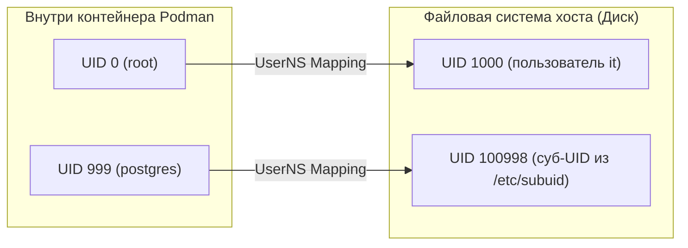
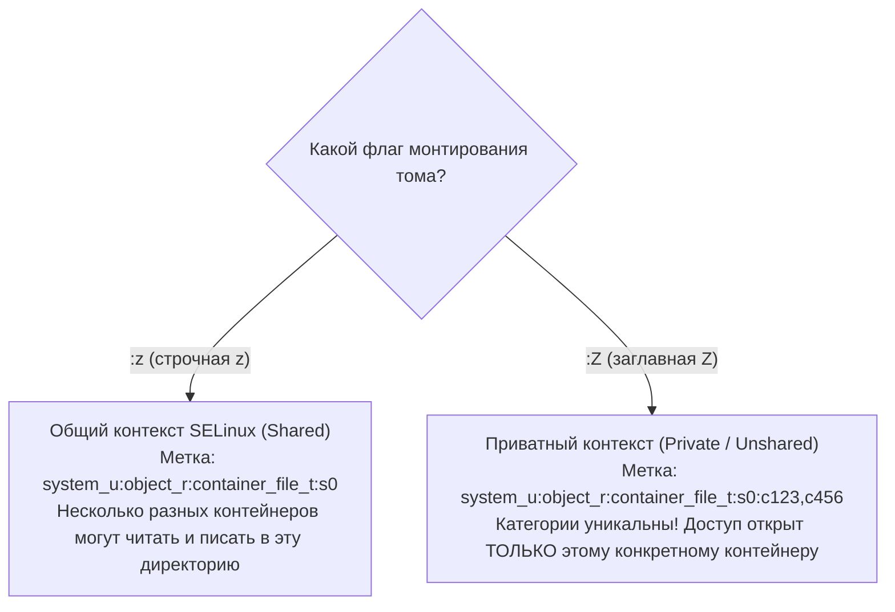

# Урок 4: Тома, права доступа и хранилище: User Namespaces, флаг :U и SELinux

Каждый инженер, переходящий с Docker на Podman, неизбежно сталкивается с ситуацией: контейнер с PostgreSQL, Nginx или собственным приложением падает при старте с ошибкой:
```text
Permission denied: /var/lib/postgresql/data
```
При этом в Docker точно такой же том или bind-mount работал без нареканий. 

Причина кроется в фундаментальном различии моделей безопасности: Docker запускает контейнеры от реального `root` хоста, игнорируя права пользователя, тогда как **Rootless Podman** строго изолирует процессы с помощью **User Namespaces** и учитывает политики **SELinux**.

В этом уроке мы детально разберем:
1. **Математику сопоставления UID/GID**: почему `root` в контейнере превращается в UID 100000 на хосте.
2. **Как навсегда победить Permission Denied**: флаги монтирования `:U` и режим `--userns=keep-id`.
3. **Утилиту `podman unshare`**: вход в пространство имен пользователя для отладки прав доступа.
4. **Контексты безопасности SELinux**: когда использовать `:z`, а когда `:Z`.
5. **Декларативные тома Quadlet `.volume`**: управление постоянными данными через systemd.

---

## 1. Как работают User Namespaces и почему возникает конфликт прав?

В классическом Linux каждый файл принадлежит определенному пользователю (UID) и группе (GID).

В Rootless Podman непривилегированный пользователь хоста (допустим, с UID `1000`) не имеет права создавать файлы от имени реального системного `root` (UID `0`) или системных пользователей вроде `postgres` (UID `999`). 

Для этого ядро Linux использует механизм трансляции **User Namespaces** и записи в файлах `/etc/subuid` и `/etc/subgid`:

```text
# /etc/subuid
it:100000:65536
```
Эта запись означает: пользователю `it` выделено 65 536 виртуальных субидентификаторов, начиная с UID `100000`.

### Таблица сопоставления (UID Mapping):

| Пользователь | UID внутри контейнера | Реальный UID на хостовой файловой системе |
|---|---|---|
| Владелец процесса (`rootless`) | `0` (внутренний root) | `1000` (ваш реальный пользователь хоста) |
| Системный пользователь 1 | `1` | `100000` |
| Демон `postgres` | `999` | `100998` (`100000 + 999 - 1`) |
| Пользователь `appuser` | `1000` | `100999` |



### Суть проблемы:
Если вы монтируете локальную папку хоста `./pgdata` (которая принадлежит вашему пользователю `1000:1000`) в контейнер PostgreSQL:
1. Внутри контейнера процесс Postgres работает от UID `999`.
2. Ядро транслирует этот запрос на хост: процесс с UID `100998` пытается писать в директорию `./pgdata`, принадлежащую UID `1000`.
3. Ядро Linux блокирует операцию: **`EACCES (Permission denied)`**!

---

## 2. Способы решения: Флаг `:U` и `--userns=keep-id`

Podman предлагает несколько элегантных механизмов решения этой проблемы без небезопасного выполнения `chmod 777`.

### Способ 1: Флаг монтирования `:U` (Chown на лету)

Флаг `:U` (от англ. *User*) указывает Podman автоматически и рекурсивно изменить владельца (`chown`) монтируемого каталога на хосте под UID и GID, от которых работает процесс внутри контейнера:

```bash
podman run -d \
  --name db-postgres \
  -v ./pgdata:/var/lib/postgresql/data:U \
  -e POSTGRES_PASSWORD=secret \
  docker.io/library/postgres:16-alpine
```

Что произошло:
Podman перед запуском определил, что контейнер запускается от UID `999` (соответствующего `100998` на хосте), и автоматически выставил права `chown -R 100998:100998 ./pgdata`. База данных стартует успешно!

---

### Способ 2: Режим `--userns=keep-id` (Для локальной разработки)

Когда вы разрабатываете код (например, на Go, Python или Node.js) и монтируете текущую рабочую директорию внутрь контейнера, вам нужно, чтобы:
1. Процесс внутри контейнера работал с тем же UID, что и ваш пользователь на хосте (UID `1000`).
2. Файлы, сгенерированные сборщиком или компилятором, оставались принадлежать вам на хосте, а не превращались в файлы пользователя `100000`.

Для этого используется флаг **`--userns=keep-id`**:

```bash
podman run --rm -it \
  --userns=keep-id \
  -v "$PWD":/app:Z \
  -w /app \
  docker.io/library/golang:1.24 \
  go build -o server .
```

С флагом `--userns=keep-id` ваш UID `1000` на хосте проецируется именно в UID `1000` внутри контейнера. Все созданные артефакты компиляции мгновенно доступны для чтения и редактирования в вашей IDE без конфликта прав.

---

## 3. Магия `podman unshare`: заглядываем внутрь пространства имен

Как администратору посмотреть на права файлов с точки зрения контейнера или вручную скорректировать владельца?

Для этого есть специальная команда **`podman unshare`**:
Она запускает оболочку shell внутри того же User Namespace, который Podman использует для запуска контейнеров:

```bash
# Обычный терминал на хосте:
whoami
# Вывод: it (UID 1000)

ls -ld ./pgdata
# Вывод: drwx------ 100998 100998 ./pgdata

# Входим в User Namespace:
podman unshare

# Внутри podman unshare:
whoami
# Вывод: root (UID 0)

ls -ld ./pgdata
# Вывод: drwx------ postgres postgres ./pgdata
```

Внутри сессии `podman unshare` вы можете выполнять привычные команды `chown`, `chmod`, `cp`, работая с виртуальными идентификаторами контейнеров:
```bash
# Назначить владельцем каталога внутреннего пользователя node (UID 1000)
chown -R 1000:1000 ./app_data

# Выйти обратно в обычный терминал хоста
exit
```

---

## 4. Контексты безопасности SELinux: флаги `:z` и `:Z`

В операционных системах семейств RHEL, Fedora, Rocky Linux и CentOS по умолчанию включен **SELinux** в режиме `Enforcing`. 

Даже если права POSIX (`chmod`) настроены идеально, SELinux заблокирует доступ непривилегированного контейнера к файлам хоста, если у них нет специальной метки безопасности `container_file_t`.

Для автоматической разметки SELinux к директиве `-v` добавляются флаги `:z` или `:Z`:



### Пример использования:

```bash
# 1. Приватный том только для одного экземпляра базы данных (:Z)
podman run -d -v /var/data/postgres:/var/lib/postgresql/data:Z,U postgres:16-alpine

# 2. Общий каталог конфигураций для нескольких контейнеров (:z)
podman run -d -v /opt/configs:/etc/app/config:z,ro nginx:alpine
```

> [!WARNING]
> Никогда не используйте заглавный флаг `:Z` при монтировании системных каталогов хоста (таких как `/`, `/etc`, `/home`). Это переразметит контекст системных файлов ядра хоста под уникальный контейнер, что сломает доступ для других служб хоста!

---

## 5. Декларативные тома Quadlet: файлы `.volume`

В инфраструктуре systemd тома можно описывать декларативно в виде файлов с расширением `.volume` в каталоге `~/.config/containers/systemd/`.

Создадим файл тома:
`~/.config/containers/systemd/pgdata.volume`

```ini
[Unit]
Description=Persistent storage volume for Postgres DB

[Volume]
# Название тома в Podman
VolumeName=pg_production_data

# Опционально: монтирование внешнего NFS / iSCSI / tmpfs
# Device=tmpfs
# Type=tmpfs
# Options=size=1G
```

И подключим его в описании службы контейнера:
`~/.config/containers/systemd/db.container`

```ini
[Unit]
Description=Production Postgres Database
After=network-online.target

[Container]
Image=docker.io/library/postgres:16-alpine
Volume=pgdata.volume:/var/lib/postgresql/data:U
Environment=POSTGRES_PASSWORD=my_secure_db_pass
PublishPort=5432:5432

[Install]
WantedBy=default.target
```

При выполнении `systemctl --user daemon-reload` генератор Quadlet автоматически создаст том и обеспечит его правильное монтирование с сохранением прав!

---

## Резюме урока

1. В Rootless Podman `root` внутри контейнера отображается в UID вашего пользователя на хосте, а системные пользователи контейнера (UID > 0) мапятся на диапазоны из `/etc/subuid`.
2. Флаг **`:U`** автоматически рекурсивно передает права на файлы директории реальному пользователю контейнера.
3. Опция **`--userns=keep-id`** проецирует UID хоста внутрь контейнера без изменений, что идеально подходит для монтирования рабочего каталога разработчика.
4. Команда **`podman unshare`** открывает shell внутри пространства имен пользователя хоста для легкой отладки и изменения владельцев файлов.
5. Для работы в системах с **SELinux** всегда используйте флаги **`:z`** (общий доступ) или **`:Z`** (приватный доступ с изоляцией категорий).
