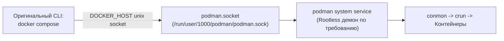

# Миграция с Docker Compose, секреты и безопасный CI/CD в Podman

Переход с Docker на Podman в реальных проектах часто вызывает практические вопросы:
* *«У нас сотни проектов на `docker-compose.yml`. Неужели всё придется переписывать?»*
* *«Как безопасно передавать пароли от баз данных и токены API без утечек в логи?»*
* *«Как запустить сборку контейнеров в CI/CD (GitLab Runner / GitHub Actions) без небезопасного Docker-in-Docker с флагом `--privileged`?»*

В этом финальном уроке трека по Podman мы решим эти задачи и закрепим production-стандарты эксплуатации контейнеров без единого root-процесса.

В этом уроке мы разберем:
1. **Два пути работы с Compose**: утилита `podman-compose` против эмуляции Docker API через сокет `podman.socket`.
2. **Безопасные секреты (Podman Secrets)**: отказ от небезопасных переменных окружения в пользу защищенных файлов в `tmpfs`.
3. **Харденинг и профили безопасности**: Seccomp, Capabilities и Read-Only контейнеры.
4. **Podman в CI/CD**: безопасные сборочные пайплайны без флага `--privileged` и без рисков компрометации хост-раннера.
5. **Итоговая матрица миграции с Docker на Podman**.

---

## 1. Миграция с Docker Compose

Если ваша команда уже использует существующие манифесты `docker-compose.yml`, переписывать их с нуля необязательно. Podman предлагает два взаимодополняющих подхода.

### Подход А: Использование нативного `docker compose` через `podman.socket` (Рекомендуется)

Podman умеет эмулировать REST API демона Docker. Для этого запускается легковесный системный сокет под управлением systemd:



#### Настройка эмуляции:
```bash
# 1. Запускаем пользовательский сокет Podman (активируется по требованию через systemd socket activation)
systemctl --user enable --now podman.socket

# 2. Проверяем путь к Unix-сокету
systemctl --user status podman.socket

# 3. Направляем официальный docker compose на сокет Podman
export DOCKER_HOST="unix://$XDG_RUNTIME_DIR/podman/podman.sock"

# 4. Запускаем ваш существующий проект без единого изменения в файле docker-compose.yml:
docker compose up -d
docker compose ps
docker compose down
```

> [!TIP]
> Чтобы переменная окружения применялась автоматически во всех терминалах, добавьте строку:
> `export DOCKER_HOST="unix://${XDG_RUNTIME_DIR}/podman/podman.sock"` в ваш `~/.bashrc` или `~/.zshrc`.

---

### Подход Б: Утилита `podman-compose`

`podman-compose` — это независимая утилита на Python, которая читает `docker-compose.yml` и напрямую транслирует инструкции в вызовы команд `podman pod create` и `podman run`:

```bash
# Установка (в Fedora/RHEL или через pip)
sudo dnf install -y podman-compose
# или: pip install --user podman-compose

# Запуск проекта
podman-compose up -d

# Остановка
podman-compose down
```

`podman-compose` отлично подходит для локальной разработки, если вы не хотите активировать systemd сокет.

---

## 2. Безопасное управление секретами: `podman secret`

Многие разработчики по привычке передают пароли от СУБД и API-ключи через переменные окружения:
```bash
# АНТИПАТТЕРН: пароль виден всем через inspect и /proc/<PID>/environ!
podman run -e DB_PASSWORD="super-secret-pass" my-app
```

Векторы утечек переменных окружения:
1. Вывод команды `podman inspect <container>` сохраняет значение переменной в открытом виде.
2. Логи сборщиков или креш-дампы (stack traces) часто распечатывают `env`.
3. Любой процесс в контейнере может прочитать `/proc/1/environ`.

### Решение: Механизм Podman Secrets
Секрет сохраняется в зашифрованном локальном хранилище Podman и монтируется внутрь контейнера как файл в оперативную память (`tmpfs`), не попадая на диск и в переменные окружения!

```bash
# 1. Создаем секрет из строки (ввод завершается нажатием Enter и Ctrl+D)
podman secret create postgres_password -

# Либо создаем секрет из файла
podman secret create jwt_private_key ./jwt_key.pem

# 2. Проверяем список секретов (значения защищены и не отображаются)
podman secret ls
```

Вывод:
```text
ID                            NAME               CREATED         UPDATED
a7d18e24c5b191a182747d9b...   postgres_password  15 seconds ago  15 seconds ago
```

#### Использование секрета в контейнере:
```bash
podman run -d \
  --name app-server \
  --secret postgres_password,type=mount,target=/run/secrets/db_password \
  my-app:latest
```

Приложение читает пароль из пути `/run/secrets/db_password`:
```go
// Пример на Go
passwordBytes, err := os.ReadFile("/run/secrets/db_password")
dbPassword := strings.TrimSpace(string(passwordBytes))
```

#### Секреты в Quadlet `.container` файлах:
```ini
[Container]
Image=registry.example.com/api:v1.0.0
Secret=postgres_password,type=mount,target=/run/secrets/db_password
Secret=jwt_private_key,type=mount,target=/run/secrets/jwt.key
```

---

## 3. Харденинг в продакшене: Seccomp, Capabilities и Read-Only

Для максимальной защиты инфраструктуры даже в случае 0-day уязвимости в коде вашего микросервиса необходимо минимизировать доступ процесса к возможностям ядра:

### 1. Файловая система Read-Only
Запрещает запись в системные каталоги контейнера:
```bash
podman run -d \
  --read-only \
  --tmpfs /tmp:rw,noexec,nosuid,size=64m \
  my-app
```
Любая попытка злоумышленника загрузить веб-шелл в `/tmp` или подменить бинарник завершится ошибкой `Read-only file system`.

### 2. Сброс привилегий ядра (Linux Capabilities)
```bash
podman run -d \
  --cap-drop=ALL \
  --cap-add=CHOWN \
  --cap-add=SETUID \
  --cap-add=SETGID \
  my-app
```
Сбросив флаг `ALL`, вы лишаете процесс возможности изменять сетевые маршруты, загружать модули ядра или перехватывать системные вызовы.

---

## 4. Безопасный CI/CD: сборка образов без флага `--privileged`

Классическая проблема в GitLab CI и GitHub Actions при использовании Docker — необходимость запускать Docker-in-Docker (DinD). Для этого раннеру требовалось давать полный доступ к ядру хоста:
```yaml
# ОПАСНО в Docker:
services:
  - docker:dind
# Требует privileged = true в config.toml GitLab Runner!
```
Если контейнер сборки взламывают через уязвимость в зависимостях npm/pip, злоумышленник получает рутовый шелл на хосте, где крутится CI Runner.

### Безопасная альтернатива: Podman Rootless в CI

Podman не требует root-демона и легко собирает образы внутри изолированного непривилегированного контейнера:

```yaml
# Пример безопасного gitlab-ci.yml
build_image:
  image: quay.io/podman/stable:latest
  stage: build
  variables:
    # Использование fuse-overlayfs для работы со слоями без привилегий
    STORAGE_DRIVER: "vfs"
  script:
    - podman login -u "$CI_REGISTRY_USER" -p "$CI_REGISTRY_PASSWORD" "$CI_REGISTRY"
    - podman build -t "$CI_REGISTRY_IMAGE:$CI_COMMIT_SHA" -f Containerfile .
    - podman push "$CI_REGISTRY_IMAGE:$CI_COMMIT_SHA"
```

Раннер работает в обычном непривилегированном режиме (`privileged = false`), гарантируя полную безопасность всей сборочной фермы компании!

---

## 5. Итоговая матрица миграции: Docker vs Podman

| Задача | Решение в Docker | Решение в Podman |
|---|---|---|
| **Запуск контейнера** | `docker run ...` | `podman run ...` (100% совместимость флагов) |
| **Автозапуск при старте ОС** | `--restart always` (требует демона) | **Quadlet** (`*.container`) через `systemctl --user` |
| **Связка микросервисов** | `docker-compose.yml` | `podman.socket` + `docker compose` или **Kubernetes YAML** (`podman kube play`) |
| **Секреты и пароли** | Docker Swarm secrets (только кластер) | **`podman secret`** (доступно локально и в systemd) |
| **Права доступа к файлам** | Файлы создаются от `root:root` | **User Namespaces**, флаги `:U`, `--userns=keep-id` |
| **Безопасность демона** | `dockerd` слушает сокет с root-правами | **Нет демона (Daemonless)**, каждый контейнер изолирован |
| **Сборка в CI/CD** | Требуется `privileged: true` | Безопасная сборка от непривилегированного пользователя |

---

## Резюме трека по Podman

1. **Podman** предоставляет полную замену Docker CLI без накладных расходов и рисков безопасности единого root-демона.
2. Благодаря **`podman.socket`** вы можете продолжать использовать стандартный `docker compose` без переписывания манифестов.
3. Инструмент **`podman secret`** гарантирует безопасное хранение чувствительных данных в оперативной памяти `tmpfs`.
4. Генератор **Quadlet** и интеграция с **Kubernetes YAML** позволяют строить зрелую инфраструктуру на базе нативных служб `systemd`.
5. Внедрение Rootless Podman в CI/CD устраняет потребность в опасном флаге `--privileged`, соответствуя самым строгим стандартам Enterprise-безопасности.
